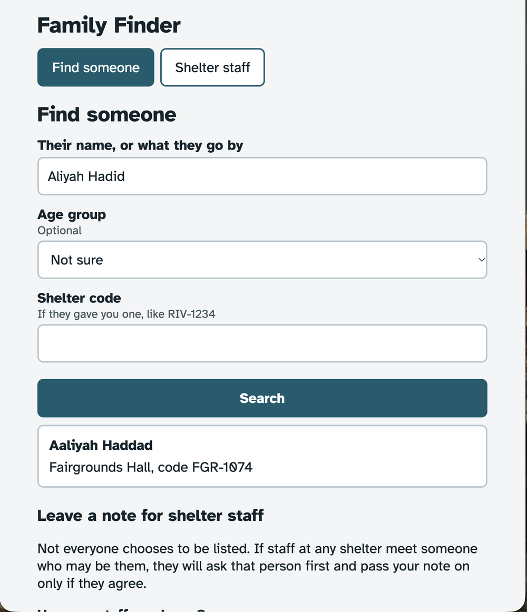
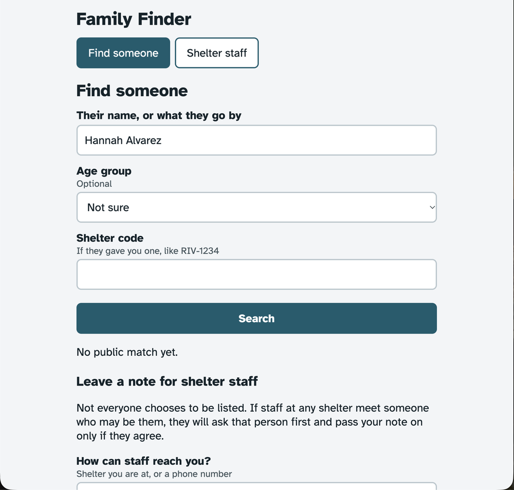
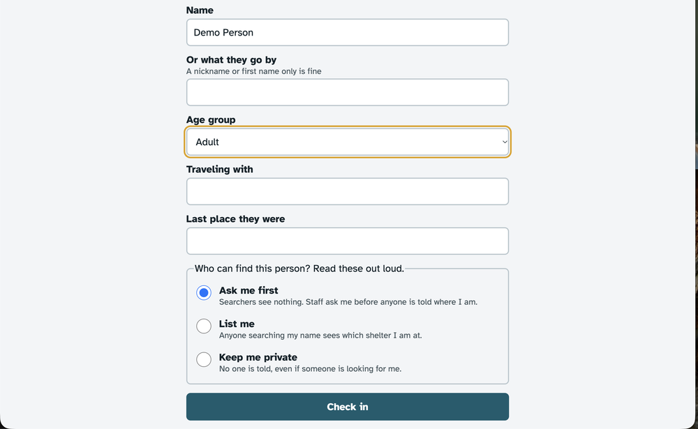
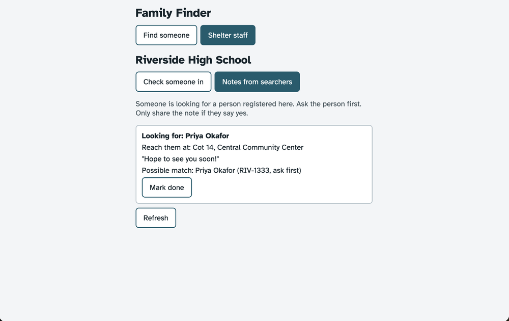

# Family Finder

A privacy-first shelter check-in and family search app for disaster evacuations. It is designed for a volunteer with about 30 seconds per person, a searcher with no phone, and a registrant who may be afraid to give a full name.

**Live app:** https://family-finder.onrender.com/

## Screenshots






## Overview
This app focuses on the part that matters most in the first 24-72 hours after a disaster: getting people safely checked in at shelters and letting families search without exposing those who do not want to be found.

I built the core workflow around three concrete user needs:
- a volunteer can register a person quickly with almost no identifying information
- a searcher can look for someone without forcing everyone to reveal their name or shelter
- a staff member can review notes from searchers without exposing protected records

The app is intentionally small and realistic. It solves the immediate operational problem without pretending that all disaster response systems are connected on day one.

## The full picture
This submission covers the “shared intake + privacy-aware search + staff inbox” slice of the system. It is the most important piece because every shelter needs one place to record people and one place to review possible matches before sharing anything sensitive.

The rest of the system would work like this:
- CSV import from paper-only shelters: volunteers or relief coordinators upload a spreadsheet, and the app maps loosely named columns such as “Name,” “Nickname,” “Age,” or “Last seen at” into the same person schema.
- SMS or radio alerts: if a shelter confirms a match, a staff member can use the code or staff-issued contact to relay the information through a more traditional local communication channel.
- Cross-agency feeds: county shelters, hospitals, and transport agencies would sync their person records into the same shared registry, while keeping a record of where information came from and when it was last updated.
- Verification question: a future version would let registrants set a personal question so a family member cannot impersonate them.
- Spanish toggle: an expanded interface would support bilingual use at shelters and among volunteers.

Where this piece fits in the broader system: the app is the operational layer that shelters actually use during the chaotic first days after a displacement event.

## Design
### Users
- Volunteer at 2 a.m.: under pressure, not technical, needs a fast intake screen with minimal typing
- Searcher with no phone: they may be using a shelter tablet or a relative’s phone and need a simple search screen
- Person being registered: they may not have ID, may be scared to use a real name, and should control visibility

### Design choices
- Every field is optional, except the shelter and visibility setting
- The app does not require a legal name or birthdate; it supports an alias or “what they go by” field instead
- Age is stored as a coarse range, not a birthday
- A staff-issued code like RIV-1234 acts as a handle when no ID or phone number exists
- The registrant chooses one of three visibility levels:
  - List me: public searchers can see the shelter
  - Ask me first: public search shows nothing; staff are notified to ask the person before sharing any information
  - Keep me private: no one is notified
- Public search blurs the difference between “not found” and “protected record” by showing the same no-match experience in both cases
- Searchers can leave a note for staff; staff see it in the shelter inbox and can ask the person before sharing any information
- Minors are treated as staff-mediated by default, which is safer in the disaster context

### Edge cases handled
- Duplicate detection across shelters is not implemented in this version. Staff still review likely matches in the shelter inbox, and records are never overwritten automatically.
- Stale records: shelter staff can refresh and review notes, and records are not treated as final without staff mediation
- Wrong information: the system does not trust name or location as definitive; note-based verification is the path for real confirmation
- Impersonators: the app supports the model for a future verification question while keeping the current scope realistic
- Minors: always staff-mediated, never auto-public
- Missing ID or phone: staff codes and note contact details are enough for the immediate workflow
- Unknown age: if the volunteer leaves age blank, the record defaults to “Ask me first” rather than “List me.”

## Technical choices
This app uses a single Express server that serves the built React frontend and also exposes the API. That gives one URL, no CORS issues, and one deployable service.

I used:
- React + Vite for the frontend
- Express for the API and served app
- Firestore through firebase-admin when a service account is provided
- in-memory fallback for local development so the app still runs without a database

The main tradeoff is that fuzzy matching is done in Node over the fetched records. That is fine for hundreds of records, which matches the challenge scope. At 400,000 people, I would move to Postgres with pg_trgm or a search engine such as Elasticsearch. The goal here is correctness and clarity under real operational constraints, not pretending to solve a whole-region response system in one night.

Another deliberate tradeoff is PIN-based staff access instead of real accounts. It is weaker than a full auth system, but it is realistic for stretched, non-technical shelter staff that are already under strain.

## Local setup
From the project root:

```bash
npm install
npm run build
npm start
```

Then open:

```text
http://localhost:3000
```

Demo shelter PINs:
- 1111
- 2222
- 3333

For Firestore, set this environment variable with the service account JSON as one line:

```bash
FIREBASE_SERVICE_ACCOUNT='{...json...}'
```

## Render deployment
This is the deployment pattern intended for the final challenge submission:

- Build command: `npm install && npm run build`
- Start command: `npm start`
- Use a single Render web service for the app and API
- Store the Firestore service account in Render as an environment variable

The live app is currently deployed at https://family-finder.onrender.com/.

## AI process notes
**Tools:** ChatGPT drafted the first pass of the Express routes and the initial React screen structure. I used a chat review pass to catch logic issues before submission.

**What I decided vs. what AI drafted:** I chose the PIN-only staff access model, the three visibility levels, and the rule that minors are always staff-mediated. AI drafted the initial route structure and the first UI pass; I refined the privacy model and tightened the matching logic.

**What review caught:** The review identified that (1) notes only matched people registered before the note was written, (2) “mark done” hid a note from every shelter, (3) unknown age silently overrode “Keep me private,” (4) the rate limiter treated all users behind Render’s proxy as one IP, (5) the Render build could skip Vite in production installs, and (6) the README had claimed duplicate detection the code did not implement. I fixed each issue in the code and README.

**Where I chose differently:** I kept the PIN auth model instead of adding full staff accounts, because the challenge is about a fast shelter workflow under stress rather than a complete identity system.

This kept the app realistic for the challenge without pretending it can solve a 400,000-person emergency response ecosystem in one night.
